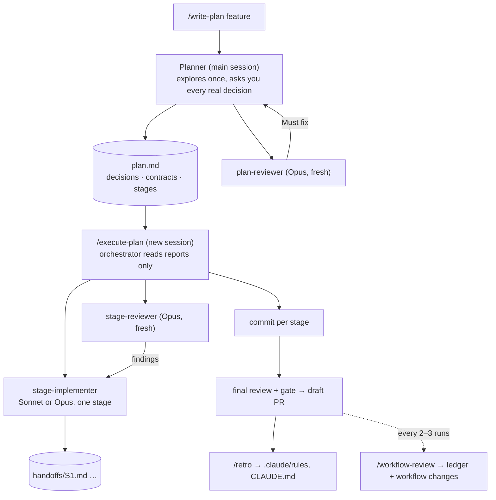
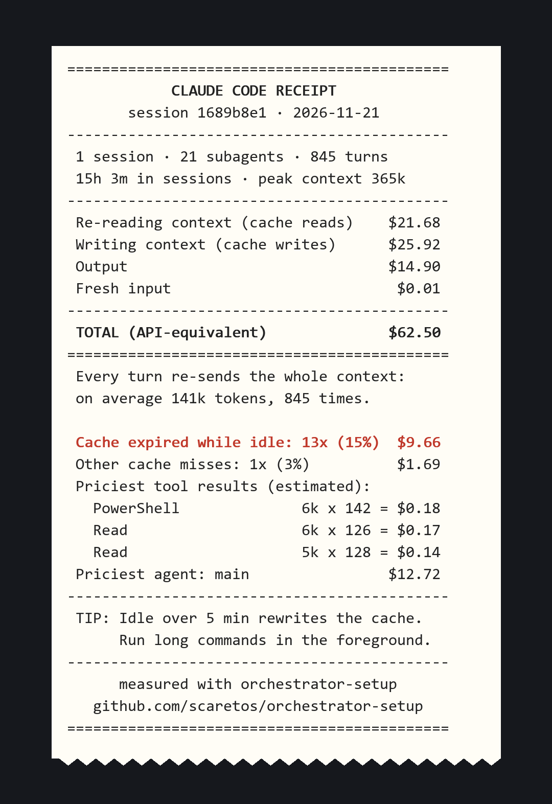

# orchestrator-setup

**Build features in large codebases with [Claude Code](https://claude.com/claude-code) without one session drowning in context. Plan once, give every stage a small fresh agent on the model that stage needs, and have each stage reviewed before it's committed.**

You plan a feature once, in depth, in your own session (`/write-plan`). Claude reads the code, asks you every decision that matters, and writes them into a plan, which a fresh Opus reviewer checks before any code exists. Then an orchestrator (`/execute-plan`) runs the plan stage by stage:

- **Each stage gets the model it needs.** A stage whose decisions are all made in the plan (wiring, mechanical changes, code the plan fully specifies) runs on Sonnet. A stage that still needs reasoning (an algorithm, unclear existing code, concurrency, security, a question only a measurement can answer) runs on Opus. The planner tags every stage, and the plan reviewer checks that no Sonnet stage is left with a decision to make.
- **Each stage is reviewed.** A fresh Opus reviewer with no stake in the code checks it against the plan and runs its tests, and the stage goes back until it passes. Only then is it committed.
- **Nobody guesses.** Implementers get the decisions, contracts and measured facts in writing. When the plan doesn't answer something, they stop and ask instead of inventing an answer and carrying on.

Small contexts also make every turn cheaper, so the setup uses fewer tokens. That's a by-product you can measure ([below](#the-by-product-see-where-your-tokens-go)), not the goal.

It came out of a real commercial codebase (a 7-project C#/.NET desktop application). Every rule in it exists because a measured run showed it was needed. See [docs/evidence.md](docs/evidence.md).

---

## The problem

In a large codebase, one session can't hold a whole feature well:

- **The context fills up.** Every file read, test output and dead end stays in the session. By the end of a large feature it carries 300k–700k tokens, and every turn works through all of it.
- **Decisions get lost, and gaps get guessed.** Choices made early drift out of focus. An agent that doesn't know an answer tends to make one up and carry on confidently.
- **One model for everything.** Either every step pays for the strongest model, or the hard steps get a weaker one.
- **Nobody checks the work in between.** Mistakes surface at the end, when other code already builds on them, and fixing them reopens finished work.
- **It gets slow and expensive.** Every turn sends the whole context again, and long sessions run into usage limits.

## What this setup does about it

| Lever | How |
|---|---|
| **Decide before you build** | The planner reads the code once and asks you every decision with more than one reasonable answer. Decisions, contracts, measured facts and test cases go into the plan; behaviour of external systems is measured, not assumed. |
| **The right model for each stage** | Sonnet for stages the plan fully specifies, Opus for stages that still need reasoning. The plan reviewer flags any Sonnet stage with a choice left in it. |
| **Every stage reviewed** | A fresh Opus reviewer per stage: plan fidelity, edge cases, tests that would actually fail if the code were wrong. Must fix items go back to the same implementer until the stage passes; a final review checks the seams between stages and runs the full verification. |
| **Stop instead of guessing** | An implementer that hits an ambiguity, or a choice others would notice, reports BLOCKED. The orchestrator answers from the plan or asks you. |
| **Mistakes found early** | A plan review before any code exists, a planner self-check built from every defect reviewers had to catch before, and checks that run in the stage that produces the behaviour. |
| **Small, fresh contexts** | One stage = one concern, grouped so no two stages read the same files, each in its own agent. The orchestrator works from short reports and never reads code, so it stays small for the whole build. |
| **Tests from independent sources** | New tests only when they check against something other than the code itself: a real system, your decision, a fixed bug. They're written before the code, from the plan. |
| **It learns** | `/retro` turns what each build taught into path-scoped rules. `/workflow-review` measures the workflow from transcripts and proposes changes, tracked in a ledger. |

## How it works



A plan is a single markdown file outside the repository (`~/.claude/plans/<feature>/plan.md`) with numbered decisions (`### D1 …`), open decisions that a named stage settles by measuring (`### O1 …`), exact contracts, and stages. Each stage lists the decisions it uses, the line ranges to read first, the tests to write *before* the code (with their inputs, expected results and source), acceptance criteria and its verify command. Agents grep the plan's headings and read only their sections. See [examples/plan-example.md](examples/plan-example.md).

Work of at most 3 stages doesn't use agents at all. One session is cheaper, and the skill tells you so.

## The by-product: see where your tokens go

Small contexts make every turn cheaper. To see what that is worth in your own sessions, measure them: one command, nothing to install.

Run this in any project you've used Claude Code in. It needs Python 3 and nothing else (on Windows, type `python` or `py` where it says `python3`):

```bash
curl -sSLO https://raw.githubusercontent.com/scaretos/orchestrator-setup/main/template/.claude/skills/workflow-review/analyze.py
python3 analyze.py receipt              # your latest session
python3 analyze.py receipt --since 7    # your last week
python3 analyze.py receipt --since 30 --all-projects --png receipt.png   # every project, as an image (needs Pillow)
```

<p align="center"></p>

This is a real receipt of one feature build (8 stages, 21 subagents). **15% of it went to context that had to be written again because a pause outlasted the prompt cache**: 13 times, an agent waited longer than its cache lives (5 minutes for subagents, an hour for the main session), on a long build, a review, or a person. On every turn, Claude Code sends the whole conversation again, so what you read, and how long you wait between turns, decides your bill more than what you write.

The receipt reads only the transcripts on your own machine (`~/.claude/projects`), sends nothing anywhere, and prices tokens at the public API rates (subscriptions pay differently; it's labelled "API-equivalent"). Add `--redact` before posting it: by default it shows the file names of your most expensive reads.

### How exact is it?

| Line | What it is | How sure |
|---|---|---|
| Token counts, cost split, TOTAL | Claude Code stores the API's own `usage` for every response in the transcript; the receipt adds them up and multiplies by the published price of the model that answered. | **Measured.** On two test sessions, the totals matched Claude Code's own `total_cost_usd` to the token and the cent ($1.1092 and $0.9832). |
| Cache expired while idle | Turns whose cache read covered less than half of the previous context, after a pause longer than the cache lifetime. Priced as the earlier context written again, minus what reading it would have cost. | **Measured** tokens, **derived** cost: it assumes the pause caused the miss. |
| Other cache misses | The same kind of miss without a long pause (a compaction, a model switch, a changed prompt). | Measured tokens, cause unknown. |
| Priciest tool results | A result's size (characters ÷ 4) × the turns it stayed in the context × the cache-read price. Already part of the total, not extra. | **Estimate.** |

Not in the transcripts, so not on the receipt: requests Claude Code may make outside the conversation. It's an "API-equivalent" figure: a subscription doesn't bill per token, so for one it shows relative usage, not money spent.

The workflow keeps these numbers down because it keeps every context small: in its measured runs, the median implementing agent peaked at 156k tokens of context, against 297k before it ([evidence](docs/evidence.md)).

## Quick start

Requirements: Claude Code with skills and subagents, git, Python 3 (for `/workflow-review` and `/restructure-docs`). Optional: Node (CRLF guard hook), `gh` (draft PRs), an LSP plugin for your language (exact `findReferences`).

```bash
git clone https://github.com/scaretos/orchestrator-setup.git
cd your-project
../orchestrator-setup/install.sh .          # macOS / Linux / Git Bash
# ..\orchestrator-setup\install.ps1 -Target .   # Windows PowerShell
```

Then, in Claude Code inside your project:

```
/orchestrator-init
```

It detects your build and test commands, shell, layout and CI, asks only what it can't detect, fills every placeholder in the skills and agents, merges the workflow sections into your `CLAUDE.md`, creates a gate script if you have none, and offers settings (each part with its reason, applied only with your OK). Commit the result on a branch.

If the project already has long documentation that agents have to find and read by hand (per-project guides, a root `CLAUDE.md` much over ~10 KB, a `docs/` folder the instructions point at), `/orchestrator-init` will point you at `/restructure-docs`. It checks every instruction against the implementation, tests, build configuration and CI, and against explicit owner decisions. It corrects or removes what the evidence contradicts, reports disagreements, and adds only high-value missing knowledge. The result is a lean root `CLAUDE.md`, folder `CLAUDE.md` files where they earn their place, and path-scoped `.claude/rules/`. Procedures move into skills, including a checklist for each kind of change your git history shows recurring. Instructions that should be enforced come back as hook or deny-rule proposals. It changes nothing before you approve the audit, and it never touches settings, hooks, `CLAUDE.local.md` or human documentation.

## Daily use

| Command | When |
|---|---|
| `/write-plan <feature>` | Anything bigger than ~3 stages, or anything that depends on an external system's behaviour. Read the plan it writes. |
| `/execute-plan <plan path>` | In a **new** session. Resumable: rerun it after an interruption, a usage limit or a new milestone. |
| `/retro` | At the end of any piece of work (the orchestrator runs it itself). Proposes rule updates; writes nothing without your OK. |
| `/workflow-review [runs]` | Every 2–3 executions. Measures and proposes workflow changes; writes nothing without your OK. |
| `/restructure-docs` | Once, after setup, if the project has hand-read guides or a large `CLAUDE.md`. Audits the context against the code, then corrects, consolidates and restructures it, and adds checklist skills; shows the audit first. |
| `/orchestrator-init` | Once after installing; again after upgrading or editing `.claude/orchestrator/profile.md`. |
| `python3 .claude/skills/workflow-review/analyze.py receipt` | Any time: the cost receipt of your latest session (`--since 7` for the week). |

## The self-improving part

There are two loops, and they improve different things:

1. **What the agents know**, through `/retro`. Implementers report a *Learned* line (a fact or trap that cost them searches), and reviewers report *Rules out of date*. At the finish, `/retro` proposes where each belongs: a `.claude/rules/*.md` file whose `paths:` match the code, so it loads automatically next time someone touches that code.
2. **How the workflow works**, through `/workflow-review`. It is the procedure from the session that produced most of this setup's rules, turned into a skill:
   - `analyze.py runs` finds the planning and execution sessions of recent plans in your transcripts (worktree sessions included).
   - `analyze.py metrics` measures every agent: turns, relative cost and API-equivalent dollars, peak context, cold cache rewrites and the idle gaps behind them, review rounds and verdicts, duplicate reads, rule files loaded, tool errors.
   - One Sonnet `workflow-analyst` per run digs into the expensive parts with `analyze.py timeline` (never by reading raw transcripts) and returns referenced evidence, measured kept separate from estimated.
   - The main session consolidates the evidence into ranked proposals. Each one comes with an exact diff, the expected saving, the quality risk and the metric the next review uses to check it.
   - You pick which to apply. Each one, and each rejection with your reason, goes into `.claude/orchestrator/ledger.md`. The next review checks whether adopted changes delivered and doesn't re-propose rejected ideas without new evidence.

The hard rule in both loops: **never trade correctness for tokens.** A proposal to drop a review or a test needs evidence that it caught nothing over several runs *and* that a cheaper check covers the same failure.

## What gets installed

```
.claude/
├── skills/
│   ├── write-plan/          SKILL.md + template.md   the planner
│   ├── execute-plan/        SKILL.md                 the orchestrator
│   ├── retro/               SKILL.md                 knowledge loop
│   ├── workflow-review/     SKILL.md + analyze.py    workflow loop
│   ├── restructure-docs/    SKILL.md + 4 scripts     audit + optimize project context
│   └── orchestrator-init/   SKILL.md                 adapts the setup to your project
├── agents/
│   ├── plan-reviewer.md     Opus, read-only
│   ├── stage-implementer.md Opus by default, Sonnet when the plan says so
│   ├── stage-reviewer.md    Opus, read-only + runs tests and the gate
│   ├── explore.md           Haiku sweeps across many files
│   └── workflow-analyst.md  Sonnet, transcript evidence for /workflow-review
├── hooks/guard-write.cjs    optional: refuses Write over CRLF files
└── orchestrator/
    ├── profile.md           the values /orchestrator-init filled in
    ├── ledger.md            what /workflow-review changed, expected, measured
    ├── claude-md-sections.md
    ├── settings.snippet.json
    └── VERSION
```

## Design principles

The full reasoning is in [docs/how-it-works.md](docs/how-it-works.md). In short:

- **Decide before you delegate.** Implementers make only local choices. Anything another stage, the user or a reviewer would notice is decided in the plan or sent back as BLOCKED.
- **Pick the model by what the stage demands.** Sonnet where the plan leaves nothing to judge, Opus where reasoning is left, Opus for every review.
- **Nothing ships unreviewed.** Every stage is checked by a fresh agent with no stake in it, against the plan and its tests, before it's committed.
- **Shift defects left.** Every Must fix a reviewer found that the planner could have found becomes a planner self-check.
- **Measure, don't assume.** External behaviour is measured with a probe before stages build on it, and workflow changes are measured before and after.
- **Keep every context small.** Each stage in its own agent, the orchestrator working from reports only, ranges instead of whole files. Quality holds up better in a small context, and every turn costs less.
- **Delegation costs a cold start.** Use agents only when the work doesn't fit one session, and never a scout for a single lookup.

## Upgrading and customizing

- Everything lives in your repository and belongs to you, so edit freely. `/workflow-review` will propose its own edits, too.
- To upgrade, run the installer with `--force` / `-Force` on a branch, then `/orchestrator-init` (it reapplies `profile.md`), and review the diff to keep your own improvements.
- Your stack's specifics (layers, traps, UI checks) live in the ADAPT blocks that `/orchestrator-init` writes. Better answers there make every run cheaper.

## FAQ

**Does it work with my language or stack?** Yes. Nothing in it is language-specific. `/orchestrator-init` fills in your build, test and gate commands. It came from a C#/.NET project; the principles are about how Claude Code works on large tasks.

**Does it stop hallucinations?** It doesn't make mistakes impossible. It makes guessing unnecessary and catches what slips through: decisions and measured facts are in writing, implementers stop with BLOCKED instead of inventing an answer, tests are written from the plan before the code, and every stage is reviewed by a fresh agent before it's committed. In the measured runs, reviewers regularly sent stages back ("changes required") before commit, which is the point.

**Do subagents save tokens?** Not automatically. Each one starts cold and reads its share again. They pay off when they keep contexts small over long work, and they cost extra on small work. Hence the ≤3-stage rule and the measurements in `/workflow-review`.

**Why are reviews always Opus, even for Sonnet stages?** Measured findings per review were worth more than the review's cost: a defect found in review costs one fix round, while the same defect found later reopens the stages built on it. `/workflow-review` will tell you if that stops being true for your project.

**Why do plans live outside the repo?** A git worktree can't see untracked files, and plans aren't code to commit. `~/.claude/plans/` is reachable from every worktree.

**Subscription or API?** Both. The analyser reports relative units (input tokens of the strongest model = 1) using published price ratios, so the numbers compare across plans and models.

## License

MIT. See [LICENSE](LICENSE). Issues and pull requests are welcome, especially measurements from other codebases (`analyze.py metrics` output, without your code).
