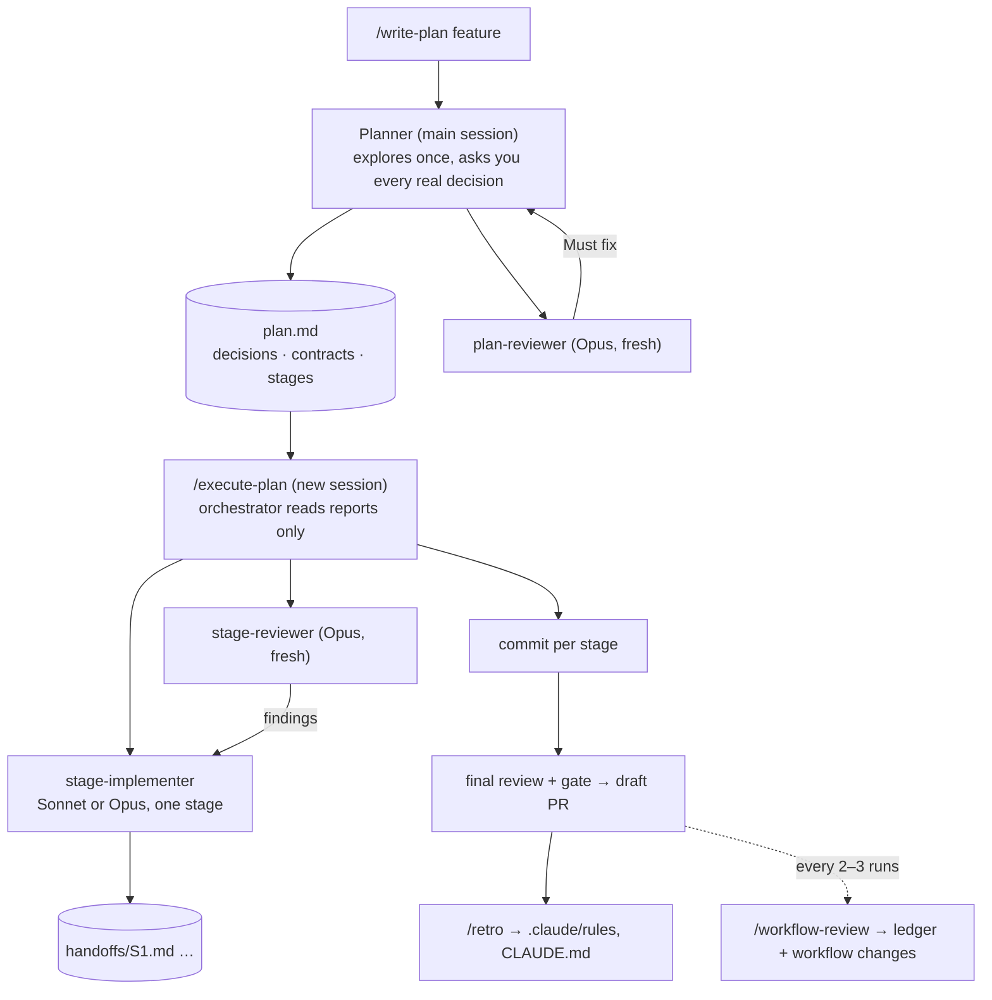

# orchestrator-setup

**A plan-then-execute workflow for [Claude Code](https://claude.com/claude-code) that keeps token usage under control as your repository grows, and measures and improves itself.**

Two commands, five agents, two improvement loops. You plan a feature once in depth (`/write-plan`), an Opus reviewer critiques the plan before any code exists, and an orchestrator (`/execute-plan`) hands each stage to a fresh, small agent: Sonnet where every decision is already made, Opus where judgment is left. A fresh Opus reviewer checks each stage, and every stage gets its own commit. After a few runs, `/workflow-review` reads the transcripts, measures where the tokens went, and proposes changes to the workflow itself.

It came out of a real commercial codebase (a 7-project C#/.NET desktop application) where long agent sessions kept hitting usage limits. Every rule in it exists because a measurement showed it pays. See [docs/evidence.md](docs/evidence.md).

---

## The problem

Claude Code's cost doesn't grow with the size of your repository directly. It grows with **how much context each turn carries** and **how many turns you need**:

- **Every turn re-reads the whole context.** A session at 300k tokens pays for 300k tokens on every tool call, even with caching (cache reads are cheaper, not free). Long sessions get more expensive per step as they go.
- **Agents start cold.** A subagent that has to find its way around a large codebase spends most of its early turns searching and reading shared docs before it edits anything. Delegating doesn't save tokens by itself.
- **The prompt cache expires.** After about 5 minutes (subagents) or an hour (main sessions) of idle time, the next turn writes the whole context again at a higher price. Waiting on long builds, polling logs and replying the next day all trigger it.
- **Rework is the most expensive token.** A design question nobody asked before coding comes back as a fix stage that reopens finished work.

In a larger repo, a single "build this feature" session drifts toward hundreds of turns and a context of 300k–700k tokens. That gets slow and expensive, and it starts hitting limits.

## What this setup does about it

| Lever | How |
|---|---|
| **Explore once** | The planner reads the code once and writes exact file ranges, decisions, contracts and test cases into the plan. Stage agents read *their* part of the plan, not the codebase. |
| **Small, fresh contexts** | One stage ≈ one concern ≈ at most 6 files. Each stage gets its own agent, so no turn pays for another stage's history. |
| **Right model for the job** | Fully specified stages run on Sonnet; stages with judgment left run on Opus; reviews always run on Opus. |
| **Find mistakes early, where they're cheap** | A plan reviewer before any code exists; a planner self-check built from every defect reviewers had to catch before; checks run in the stage that produces the behaviour. |
| **A thin orchestrator** | It works from short agent reports only and never reads code, diffs or logs, so its context stays small for the whole build. |
| **No idle cache expiry** | Foreground commands with long timeouts instead of polling; fix rounds only while the agent's cache is still warm; a new session after long pauses. |
| **Tests that earn their tokens** | New tests only when they check against something independent of the code (a real system, an owner decision, a fixed bug). This guards quality and cuts the test-writing overhead. |
| **It learns** | `/retro` turns what each build taught into path-scoped rules. `/workflow-review` measures the workflow from transcripts and proposes changes, tracked in a ledger. |

## How it works



A plan is a single markdown file outside the repository (`~/.claude/plans/<feature>/plan.md`) with numbered decisions (`### D1 …`), open decisions that a named stage settles by measuring (`### O1 …`), exact contracts, and stages. Each stage lists the decisions it uses, the line ranges to read first, the tests to write *before* the code (with their inputs, expected results and source), acceptance criteria and its verify command. Agents grep the plan's headings and read only their sections. See [examples/plan-example.md](examples/plan-example.md).

Work of at most 3 stages doesn't use agents at all. One session is cheaper, and the skill tells you so.

## Quick start

Requirements: Claude Code with skills and subagents, git, Python 3 (for `/workflow-review`). Optional: Node (CRLF guard hook), `gh` (draft PRs), an LSP plugin for your language (exact `findReferences`).

```bash
git clone https://github.com/scaretos/orchestrator-setup.git
cd your-project
../orchestrator-setup/install.sh .          # macOS / Linux / Git Bash
# ..\orchestrator-setup\install.ps1 -Target .   # Windows PowerShell
```

Then, in Claude Code inside your project:

```
/orchestrator-init
```

It detects your build and test commands, shell, layout and CI, asks only what it can't detect, fills every placeholder in the skills and agents, merges the workflow sections into your `CLAUDE.md`, creates a gate script if you have none, and offers settings (each part with its reason, applied only with your OK). Commit the result on a branch.

## Daily use

| Command | When |
|---|---|
| `/write-plan <feature>` | Anything bigger than ~3 stages / ~15 files, or anything that depends on an external system's behaviour. Read the plan it writes. |
| `/execute-plan <plan path>` | In a **new** session. Resumable: rerun it after an interruption, a usage limit or a new milestone. |
| `/retro` | At the end of any piece of work (the orchestrator runs it itself). Proposes rule updates; writes nothing without your OK. |
| `/workflow-review [runs]` | Every 2–3 executions. Measures and proposes workflow changes; writes nothing without your OK. |
| `/orchestrator-init` | Once after installing; again after upgrading or editing `.claude/orchestrator/profile.md`. |

## The self-improving part

There are two loops, and they improve different things:

1. **What the agents know**, through `/retro`. Implementers report a *Learned* line (a fact or trap that cost them searches), and reviewers report *Rules out of date*. At the finish, `/retro` proposes where each belongs: a `.claude/rules/*.md` file whose `paths:` match the code, so it loads automatically next time someone touches that code.
2. **How the workflow works**, through `/workflow-review`. It is the procedure from the session that produced most of this setup's rules, turned into a skill:
   - `analyze.py runs` finds the planning and execution sessions of recent plans in your transcripts (worktree sessions included).
   - `analyze.py metrics` measures every agent: turns, relative cost, peak context, cold cache rewrites and the idle gaps behind them, review rounds and verdicts, duplicate reads, rule files loaded, tool errors.
   - One Sonnet `workflow-analyst` per run digs into the expensive parts with `analyze.py timeline` (never by reading raw transcripts) and returns referenced evidence, measured kept separate from estimated.
   - The main session consolidates the evidence into ranked proposals. Each one comes with an exact diff, the expected saving, the quality risk and the metric the next review uses to check it.
   - You pick which to apply. Each one, and each rejection with your reason, goes into `.claude/orchestrator/ledger.md`. The next review checks whether adopted changes delivered and doesn't re-propose rejected ideas without new evidence.

The hard rule in both loops: **never trade correctness for tokens.** A proposal to drop a review or a test needs evidence that it caught nothing over several runs *and* that a cheaper check covers the same failure.

## What gets installed

```
.claude/
├── skills/
│   ├── write-plan/          SKILL.md + template.md   the planner
│   ├── execute-plan/        SKILL.md                 the orchestrator
│   ├── retro/               SKILL.md                 knowledge loop
│   ├── workflow-review/     SKILL.md + analyze.py    workflow loop
│   └── orchestrator-init/   SKILL.md                 adapts the setup to your project
├── agents/
│   ├── plan-reviewer.md     Opus, read-only
│   ├── stage-implementer.md Opus by default, Sonnet when the plan says so
│   ├── stage-reviewer.md    Opus, read-only + runs tests and the gate
│   ├── explore.md           Haiku sweeps across many files
│   └── workflow-analyst.md  Sonnet, transcript evidence for /workflow-review
├── hooks/guard-write.cjs    optional: refuses Write over CRLF files
└── orchestrator/
    ├── profile.md           the values /orchestrator-init filled in
    ├── ledger.md            what /workflow-review changed, expected, measured
    ├── claude-md-sections.md
    ├── settings.snippet.json
    └── VERSION
```

## Design principles

The full reasoning, with the cost model behind it, is in [docs/how-it-works.md](docs/how-it-works.md). In short:

- **Context is paid on every turn.** Read ranges, not files. Read each thing once. Batch independent calls into one turn.
- **Delegation costs a cold start.** Use agents only when the work doesn't fit one session, and never a scout for a single lookup.
- **Decide before you delegate.** Implementers make only local choices. Anything another stage, the user or a reviewer would notice is decided in the plan or sent back as BLOCKED.
- **Shift defects left.** Every Must fix a reviewer found that the planner could have found becomes a planner self-check.
- **Keep the orchestrator blind.** It works from reports, not code, so its context stays small for the whole build.
- **Measure, don't assume.** External behaviour is measured with a probe before stages build on it, and workflow changes are measured before and after.

## Upgrading and customizing

- Everything lives in your repository and belongs to you, so edit freely. `/workflow-review` will propose its own edits, too.
- To upgrade, run the installer with `--force` / `-Force` on a branch, then `/orchestrator-init` (it reapplies `profile.md`), and review the diff to keep your own improvements.
- Your stack's specifics (layers, traps, UI checks) live in the ADAPT blocks that `/orchestrator-init` writes. Better answers there make every run cheaper.

## FAQ

**Does it work with my language or stack?** Yes. Nothing in it is language-specific. `/orchestrator-init` fills in your build, test and gate commands. It came from a C#/.NET project; the principles are about how Claude Code spends tokens.

**Do subagents save tokens?** Not automatically. Each one starts cold and reads its share again. They pay off when they keep contexts small over long work, and they cost extra on small work. Hence the ≤3-stage rule and the measurements in `/workflow-review`.

**Why are reviews always Opus, even for Sonnet stages?** Measured findings per review were worth more than the review's cost: a defect found in review costs one fix round, while the same defect found later reopens the stages built on it. `/workflow-review` will tell you if that stops being true for your project.

**Why do plans live outside the repo?** A git worktree can't see untracked files, and plans aren't code to commit. `~/.claude/plans/` is reachable from every worktree.

**Subscription or API?** Both. The analyser reports relative units (input tokens of the strongest model = 1) using published price ratios, so the numbers compare across plans and models.

## License

MIT. See [LICENSE](LICENSE). Issues and pull requests are welcome, especially measurements from other codebases (`analyze.py metrics` output, without your code).
